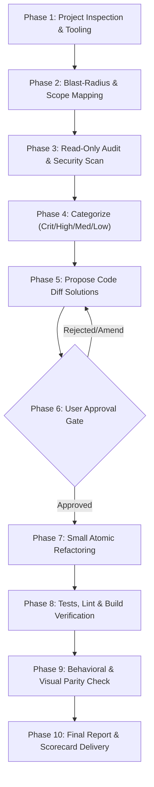

# Code Quality & Safe Modernization Skill (`code-quality-modernizer`)

A disciplined, evidence-backed skill for auditing codebases, securing applications against OWASP vulnerabilities, and executing safe, zero-regression modernization and refactoring.

---

## 1. Objective & Core Philosophy

The primary objective of `code-quality-modernizer` is to transform complex, outdated, brittle, and unmaintainable code into clean, readable, robust, and modern code **without altering runtime behavior or breaking existing features**.

### Guiding Principles:
1. **Zero-Regression Guarantee:** A refactor is only successful if existing functionality, performance characteristics, and edge cases continue to behave identically.
2. **Blast-Radius Awareness:** Never modify a file without assessing its dependency footprint across the repository.
3. **Fintech-Grade Security:** Enforce OWASP Top 10 standards. Zero tolerance for unescaped inputs, credential logging, or authorization bypasses.
4. **Clarity Over Cleverness:** Never optimize code merely to reduce line count (no "code golfing"). Verbose code that is readable and explicit is far superior to terse, cryptic one-liners.
5. **Read-Only First:** Never mutate code during audit or reconnaissance. The audit phase is strictly read-only.
6. **Approval Before Mutation:** Never modify source files without presenting the audit findings, proposed diffs, risk assessment, and obtaining explicit user confirmation.
7. **Atomic Increments:** Refactor in small, verifiable, independent steps. Run builds and tests after every single change.

---

## 2. Inviolable Constraints: Feature & Contract Preservation

The following boundaries must **never** be violated:

| Area | Inviolable Constraint |
| :--- | :--- |
| **Business Logic** | Existing business rules, validation logic, edge-case fallbacks, and calculations must remain exact. |
| **API Contracts** | Route signatures, status codes, payload shapes, headers, query params, and error schemas must not change. |
| **Props & Export Lock** | Component props, default values, event handler signatures, and exported function interfaces are strictly locked. |
| **Database & Schema** | Database schemas, column names, migrations, and query semantics must not change without explicit approval. |
| **UI & UX** | Component layouts, styling, user interactions, animation timings, and responsiveness must stay identical. |
| **Dead Code Pruning** | Never remove code simply because it *looks* unused. Every deletion requires static and dynamic reference evidence. |
| **Dependency Upgrades**| Never bump major dependency versions automatically (e.g., React 18 to 19, Node 18 to 22) during refactoring. |

---

## 3. Mandatory 10-Phase Workflow

Every modernization and refactoring task must strictly execute through these 10 sequential phases:



### Phase 1: Inspect Project Structure
- Identify root directory, workspace packages (monorepo vs polyrepo), build tools (`vite`, `webpack`, `tsup`), package manager (`npm`, `pnpm`, `yarn`), and runtime targets.
- Detect stack: Languages (`ts`, `js`, `jsx`, `tsx`), Frameworks (`React`, `Express`, `Next.js`), Libraries (`shadcn/ui`, `Tailwind`, `Prisma`, `Knex`, `Mongoose`), and DB engines (`PostgreSQL`, `MySQL`, `MongoDB`).

### Phase 2: Blast-Radius & Scope Mapping
- Determine how many files in the workspace import the target file:
  - **Low Blast Radius (0 to 2 imports):** Isolated module/page. Safe for focused refactoring.
  - **Medium Blast Radius (3 to 7 imports):** Shared component/utility. Requires caller-site inspection.
  - **High Blast Radius (8+ imports):** Core architectural hub (e.g., `api.ts`, `AuthContext.tsx`, `DashboardLayout.tsx`). Requires strict interface locking and full regression testing across all consumers.
- Use the built-in helper script:
  ```bash
  python .agents/skills/code-quality-modernizer/scripts/audit_scanner.py <target_path> <project_root>
  ```

### Phase 3: Read-Only Audit & Security Scan
- Traverse target files without making any edits or deletions.
- Detect code quality and security smells across the **8 Core Audit Pillars**:
  1. **Security Vulnerabilities (OWASP):** Sensitive PII logging, unescaped XSS sinks, SQL interpolation, insecure token storage.
  2. **Unnecessary Complexity:** Deep nesting (pyramid of doom), cyclomatic complexity > 15.
  3. **Duplicate Logic:** Redundant abstractions, repeated API fetching logic or formatting helpers.
  4. **Dead Code & Unused Items:** Unused imports, variables, unreachable branches, and orphaned components.
  5. **Deprecated APIs & Anti-Patterns:** Obsolete React lifecycle patterns, missing hook dependencies, unhandled Promise rejections.
  6. **Performance Bottlenecks:** Unmemoized expensive computations, unnecessary re-renders, unclosed connections or event listeners.
  7. **Type Safety Dilution:** Overuse of `: any`, missing interface definitions, missing null checks.
  8. **Outdated Dependencies:** Known vulnerable or legacy package patterns.

### Phase 4: Categorize Findings
Classify every detected finding into one of 4 priority levels:
- **Critical:** Security vulnerability (PII leak, SQLi, XSS), unhandled async rejection causing crash, memory leak.
- **High:** High blast-radius logic duplication, fragile error handling, extreme cyclomatic complexity, or missing hook cleanup.
- **Medium:** Outdated syntax (callbacks instead of async/await, missing optional chaining, obsolete React hooks anti-pattern), unneeded re-renders.
- **Low:** Minor code cleanliness, redundant local variables, dead imports, style inconsistencies.

### Phase 5: Propose Improvements (Current vs Recommended)
- For every finding, provide side-by-side or before-and-after code snippets.
- Document the exact file path and line numbers.
- State the specific benefit (e.g., "Eliminates duplicate API call logic", "Secures against XSS", "Flattens 4 levels of nested if statements").
- Clearly indicate the risk level and required verification step.

### Phase 6: Wait for Approval (Decision Gate)
- Present the audit findings, Blast Radius assessment, and proposed refactor plan to the user.
- **STOP.** Do not modify a single line of code until the user approves the scope, specific files, or tier of changes.

### Phase 7: Atomic Refactoring (Small Independent Steps)
- Once approved, apply changes incrementally.
- Refactor one function, one hook, or one file at a time.
- Avoid batching unrelated refactors into a single change set.
- Lock all interface signatures and props.

### Phase 8: Verification Loop (Build, Lint, Tests)
- Immediately after each atomic change:
  - Run TypeScript typecheck (`tsc --noEmit` or equivalent).
  - Run linter (`eslint` or equivalent).
  - Run existing test suites.
  - Run production build (`npm run build`).
- If any step fails, investigate immediately. Do not proceed to the next file until the current one passes cleanly.

### Phase 9: Behavioral Parity Check
- Verify that inputs and outputs produce identical results across standard paths and edge cases (e.g., `null`, `undefined`, empty arrays, error rejections).
- Verify that UI components maintain exact visual appearance, props handling, and event handlers.

### Phase 10: Final Verification Report & Scorecard
- Generate a structured summary of:
  - All modified files.
  - Improvements achieved.
  - Test and build execution logs.
  - Code Health Scorecard (A to F) before and after.

---

## 4. Security & OWASP Top 10 Audit Rules

Fintech and business applications require strict security discipline. The following rules are enforced:

### A. PII & Sensitive Credential Protection
- **No Console Leaks:** Never log customer PAN, Aadhaar, bank account numbers, passwords, or bearer tokens via `console.log()` or `console.error()`.
- **Masking:** When debugging or rendering identifiers, mask sensitive numbers (e.g., `XXXX-XXXX-1234`).
- **No Hardcoded Secrets:** JWT secrets, API keys, or private database credentials must reside strictly in environment variables (`.env`).

### B. XSS & Injection Immunity
- **React Sinks:** Avoid `dangerouslySetInnerHTML`. If strictly required for rich text, sanitize with a trusted sanitizer (e.g., `DOMPurify`).
- **SQL Parameterization:** Never concatenate variables or use template literals inside SQL queries (`SELECT * FROM users WHERE id = ${id}`). Always use parameterized queries (`$1`, `?`).

### C. Authorization & Route Guards
- **Frontend & Backend Dual Verification:** Never rely solely on frontend navigation hiding (`display: none` or conditional button rendering) for security. Ensure API endpoints enforce session token verification and RBAC (Role-Based Access Control) on the server.
- **IDOR / BOLA Prevention:** Ensure operations mutating user resources verify that the resource belongs to the currently authenticated user session.

---

## 5. Multi-Stack Modernization Rules

The skill automatically adapts to the project stack:

### A. TypeScript & Modern JavaScript
- **Optional Chaining & Nullish Coalescing:** Replace verbose guards (`a && a.b && a.b.c !== null && a.b.c !== undefined ? a.b.c : 'default'`) with `a?.b?.c ?? 'default'`.
- **Async / Await:** Convert legacy `.then().catch()` promise chains and callback hell into linear `async/await` with structured `try...catch` or modern error tuple wrappers.
- **Object / Array Destructuring:** Simplify repetitive property access.
- **Strict Typing:** Replace `any` with precise union types, generics, or `unknown` with runtime type narrowing.
- **Dead Code:** Clean up unused imports, orphaned variables, and unreachable code branches.

### B. React (Modern 18+ Patterns)
- **Hooks Modernization:** Clean up obsolete patterns. Never introduce unnecessary `useEffect` when state can be derived during render.
- **State Colocation:** Avoid lifting state higher than necessary; keep component state close to where it is consumed.
- **Custom Hook Extraction:** When component logic exceeds 200 lines due to side-effects or form handling, extract cohesive logic into custom hooks without altering the component's external props.
- **Stable References:** Use `useCallback` and `useMemo` strictly when reference equality is needed (e.g., dependency in another hook or memoized child), not blindly on every scalar.
- **Clean JSX:** Avoid deeply nested ternary operators in JSX (`cond1 ? (cond2 ? <A/> : <B/>) : (cond3 ? <C/> : <D/>)`). Extract into early returns, sub-components, or mapping dictionaries.

### C. Node.js & Express
- **Async Route Handlers:** Ensure all async Express route handlers properly catch errors and pass them to `next(err)` or use an async-handler wrapper to prevent unhandled promise rejections.
- **Middleware Organization:** Decouple monolithic route files by separating validation, authentication, controller logic, and service layers.
- **Resource Management:** Ensure streams, file descriptors, and database connections are properly closed or returned to the pool using `finally` blocks or modern disposable patterns.
- **Environment & Secrets:** Eliminate hardcoded config strings or fallback secrets; centralize in validated environment modules.

---

## 6. Audit Report & Scorecard Specification

When generating the audit report (Phase 3–5), use the following standardized structure:

````markdown
# Code Quality & Modernization Audit Report

## 1. Executive Summary & Health Scorecard
- **Target:** `path/to/target`
- **Stack Detected:** [e.g., React 18, Vite, TypeScript, Express, PostgreSQL]
- **Blast Radius:** [Low / Medium / High] ([X] referencing files)
- **Code Health Grade:** [Grade: A / B / C / D / F]
- **Findings Count:** [X Critical, Y High, Z Medium, W Low]

---

## 2. Prioritized Findings

### [Finding ID]: [Descriptive Title]
- **File & Line:** `path/to/file.ts#L45-L78`
- **Category:** [Security / Complexity / Duplication / Deprecated / Performance / TypeSafety]
- **Severity:** [Critical / High / Medium / Low]
- **Current Implementation:**
```typescript
// Existing problematic code
```
- **Identified Problem:**
  [Detailed description of why this code is problematic, risky, or outdated]
- **Recommended Modern Implementation:**
```typescript
// Proposed clean, safe replacement with locked props/types
```
- **Expected Benefit:** [e.g., Eliminates PII leak, improves readability]
- **Risk Level:** [None / Low / Medium]
- **Verification Plan:** [e.g., Unit tests, TypeScript build check, visual sanity check]

---

## 3. Recommended Execution Batches
- **Batch 1 (Critical & High Priority / Security):** [List findings]
- **Batch 2 (Medium Priority / Cleanliness & Performance):** [List findings]
- **Batch 3 (Low Priority / Polish):** [List findings]
````

---

## 7. Safety Rules & Rollback Protocol

> [!CAUTION]
> **Strict Operational Prohibitions:**
> - **NEVER** line-golf (e.g., converting a clear 5-line `if/else` block into an obscure nested ternary or bitwise trick).
> - **NEVER** modify or delete an exported interface, component prop, or API response format without explicit authorization.
> - **NEVER** alter database schema, column names, or default constraints during a refactor.
> - **NEVER** batch multi-file refactors without running builds and tests after each file.
> - **NEVER** claim a refactor is safe without showing compiler, linter, or test output.

### Rollback Procedure:
If any compilation error, test failure, or visual regression occurs:
1. **Immediate Stop:** Do not apply patch-over edits.
2. **Revert Immediately:** Run `git checkout -- <file>` or `git restore <file>`.
3. **Transparent Reporting:** Report the exact failure and diagnostic details to the user before attempting any alternative strategy.
